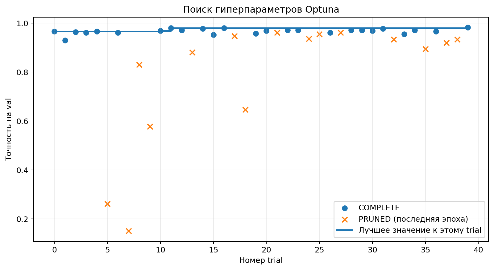
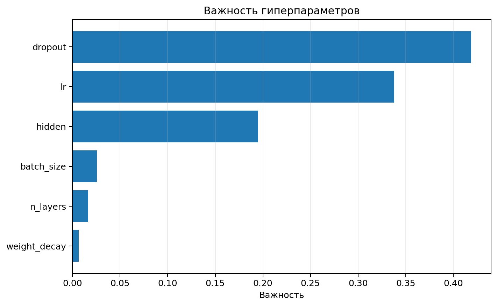

# Лабораторная работа 0. Воспроизводимый эксперимент

## Вопрос и прогноз

**Главный вопрос:** дал ли подбор гиперпараметров улучшение, которое больше случайного разброса?

До запусков был зафиксирован прогноз: разброс точности базовой конфигурации на `val` при смене `seed` будет меньше 1 процентного пункта; лучший trial Optuna превзойдёт базовую конфигурацию примерно на 1–2 п.п.; после переобучения с новыми `seed` и проверки на `test` часть улучшения исчезнет. Прогноз сохранён в `prediction.md` до экспериментов.

## Система и данные

Использован набор `sklearn.datasets.load_digits`: 1797 изображений цифр 8×8, представленных 64 признаками со значениями от 0 до 16. Признаки делились на 16 без вычисления статистик по `val` или `test`. Стратифицированное разбиение с `split_seed=0` дало 1077 записей `train`, 360 `val` и 360 `test`. Индексы сохранены в `data/split.json`; его SHA-256 — `d3ba070d3282c94e67fcf0f0bd7c10e0efc97dbcb00c07397313e14d38b5931a`. Источник, версия `scikit-learn`, правило и размеры разбиения записаны в `data/manifest.json`.

Каркас запуска устроен так:

```text
config.yaml + data/split.json + Git-коммит
                    |
                 train.py
                    |
       runs/<run_id>/ + MLflow Tracking
                    |
 config, metadata, history, predictions, metrics

Optuna search.py --> тот же train.py --> вложенные MLflow runs
analyze.py -------> таблицы, сводка и рисунки отчёта
```

Модель — MLP: 64 входа, от одного до трёх скрытых слоёв с ReLU и dropout, 10 выходов. Использовались кросс-энтропия, Adam и 30 эпох. Для повторяемости фиксировались `random`, NumPy и PyTorch seed, генератор `DataLoader`, `num_workers=0`, один поток CPU и детерминированные алгоритмы PyTorch. Каждый итоговый запуск проверял чистоту Git и сохранял итоговую конфигурацию, коммит, версии библиотек, историю по эпохам, предсказания и метрики. Метрики пересчитывались из сохранённых CSV.

## Эксперимент 1. Повторяемость и разброс

Два итоговых запуска базовой конфигурации с `seed=0` дали одинаковые `predictions.csv` и одинаковую историю вычисляемых метрик. Реальное время эпох не обязано совпадать. Запуск с другим seed дал другие предсказания.

Серия `base_seeds`, знаменатель каждого запуска: **360 изображений val**.

| Seed | Точность val | Время обучения, с |
|---:|---:|---:|
| 1 | 96,11% | 0,7927 |
| 2 | 95,83% | 0,9917 |
| 3 | 95,56% | 1,0224 |
| 4 | 95,56% | 0,8126 |
| 5 | 95,83% | 0,8247 |

Минимум, медиана и максимум равны 95,56%, 95,83% и 96,11%. Размах — **0,56 п.п.**, то есть две записи из 360. Прогноз о разбросе меньше 1 п.п. подтвердился. При сравнении `seed=1` и `seed=2` первый запуск правильно классифицировал одну запись, ошибочную во втором; обратных случаев не было. Даже близкая итоговая точность может скрывать разные ошибки.

## Эксперимент 2. Optuna

Study `lr0_search` использовала `TPESampler(seed=42)` и `MedianPruner(n_startup_trials=5, n_warmup_steps=5)`. Поиск выполнялся последовательно. После первых 10 trial процесс был остановлен и затем продолжен из той же SQLite-базы до 40 trial. Во всех trial были фиксированы разбиение, `seed=0` и 30 эпох.

Из 40 trial завершились 25, прунером остановлены 15, состояний `FAIL` не было. Фактически выполнено **833 из 1200 эпох**; прунер сэкономил 367 эпох, или **30,6%**. Измеренное время обучения составило 81,05 с; оценка сэкономленного времени — 28,70 с.



Лучшим стал trial 39 с точностью `val` **98,33%** и параметрами:

- `lr = 0.005756867015168353`;
- `n_layers = 3`;
- `hidden = 438`;
- `dropout = 0.050270207171060705`;
- `weight_decay = 1.7694297178024922e-05`;
- `batch_size = 128`.



Наибольшая важность получена для `dropout` (0,419), `lr` (0,338) и `hidden` (0,195). Важность описывает данный поиск и его пространство, а не универсальное свойство MLP.

## Эксперимент 3. Честное сравнение

Лучшая конфигурация была сохранена и закоммичена до доступа к `test`. Серии `final_base` и `final_best` запускались с новыми `seed=101…105`. Знаменатель каждой оценки — **360 изображений** соответствующей части.

| Seed | Base val | Best val | Δval | Base test | Best test | Δtest |
|---:|---:|---:|---:|---:|---:|---:|
| 101 | 95,56% | 95,83% | +0,28 п.п. | 95,56% | 94,44% | -1,11 п.п. |
| 102 | 95,00% | 97,22% | +2,22 п.п. | 94,17% | 97,22% | +3,06 п.п. |
| 103 | 95,56% | 97,78% | +2,22 п.п. | 94,17% | 96,67% | +2,50 п.п. |
| 104 | 95,00% | 97,22% | +2,22 п.п. | 95,00% | 96,11% | +1,11 п.п. |
| 105 | 95,28% | 97,50% | +2,22 п.п. | 95,56% | 98,06% | +2,50 п.п. |

Медиана Δval равна +2,22 п.п., диапазон — от +0,28 до +2,22 п.п. Медиана Δtest равна **+2,50 п.п.**, диапазон — от **-1,11 до +3,06 п.п.** Суммарно по пяти seed лучшая конфигурация исправила 54 ошибочных решения базовой и испортила 25 верных из 1800 парных решений.

Точность лучшего trial на поисковом `val` равна 98,33%; средняя точность лучшей конфигурации на `val` с новыми seed — 97,11%; средняя точность на `test` — 96,50%. Снижение после отбора согласуется со смещением выбора лучшего из 40 вариантов на одной `val`-выборке.

## Вывод и ограничения

Подбор гиперпараметров дал положительное улучшение в среднем: средняя точность на test выросла с 94,89% до 96,50%, а медианная парная разность составила +2,50 п.п. Однако строгий критерий задания не выполнен: при `seed=101` разность на test отрицательна (-1,11 п.п.), тогда как естественный размах базовой конфигурации равен 0,56 п.п. Поэтому **по пяти повторам недостаточно данных, чтобы утверждать, что улучшение устойчиво**. Корректная формулировка: найденная конфигурация перспективна и чаще превосходит базовую, но эффект зависит от seed.

Вывод относится к `load_digits`, указанному разбиению, CPU, зафиксированным версиям библиотек, данной MLP и бюджету в 40 trial. `test` использовался только в серии `final`; после просмотра его результатов система не изменялась и повторно не оценивалась.

## Проверка сгенерированного кода

Код `prepare_data.py`, `train.py`, `search.py` и `analyze.py` был подготовлен с помощью языковой модели. Проверка включала: размеры и непересечение частей; наличие всех 10 классов; совпадение SHA-256; пример точности 0,75; пересчёт точности из `predictions.csv`; два одинаковых запуска с `seed=0`; различие запуска с `seed=1`; отказ итогового запуска при грязном Git-дереве; продолжение Optuna после 10 trial; сверку всех итоговых метрик из сохранённых файлов. Синтаксис скриптов проверялся до загрузки, а полный конвейер был выполнен в Colab.

## Источники

1. [scikit-learn: `load_digits`](https://scikit-learn.org/stable/modules/generated/sklearn.datasets.load_digits.html).
2. [PyTorch: `torch.use_deterministic_algorithms`](https://docs.pytorch.org/docs/main/generated/torch.use_deterministic_algorithms.html).
3. [Optuna: `MedianPruner`](https://optuna.readthedocs.io/en/stable/reference/generated/optuna.pruners.MedianPruner.html).
4. [MLflow: Experiment Tracking](https://mlflow.org/docs/latest/ml/tracking/).
